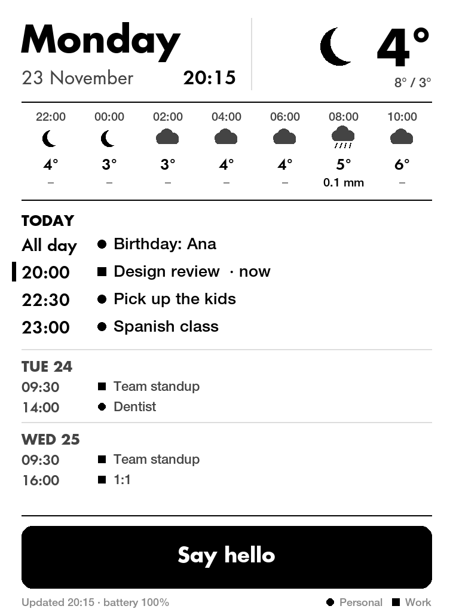

# Kindle dashboard

An old Kindle turned into an always-on living-room screen: clock, today's weather, your calendars for the week, and touch buttons that run whatever you want (mine starts the robot vacuum).



**This is not a product, and it's not meant to be generic.** It's a working starting point with all the hard-won Kindle knowledge written down. The intended way to use it:

## How to use this repo

1. Clone it, plug your Kindle into your computer, and open [Claude Code](https://claude.com/claude-code) in this folder.
2. Tell it what you have and what you want, for example:
   > "I have a Kindle Paperwhite on firmware 5.x. Help me jailbreak it, then set this up with my Google calendar and the weather for Lisbon. I want a button that turns off my Hue lights."
3. Claude Code reads [`CLAUDE.md`](CLAUDE.md), which covers the jailbreak path, the Kindle's many quirks, how to deploy, and the stability rules. It walks you through the rest and writes whatever custom glue you need (a button script for your vacuum, lights, garage door, a different data source...).

Expect it to be custom. Your integrations go in `kindle/integrations/` and your settings in `kindle/config.json` (never committed). Keep them on your own branch.

## What it does

- **Clock and date**: the clock area refreshes every minute without flashing the screen.
- **Weather** from [Open-Meteo](https://open-meteo.com/) (free, no API key): current temperature, today's high/low and rain, and a 2-hourly strip with mm of rain.
- **Calendars**: any number of iCal (`.ics`) links, recurring events included, each with its own marker shape. Google Calendar's "secret address in iCal format" works.
- **Buttons**: up to 4 touch buttons, each runs a shell command on the Kindle. Exit code 0 shows "Done", anything else "Failed".
- **Runs unattended**: starts at boot, keeps the Kindle awake, survives broken data and network outages, keeps the last good data on screen, rotates its log, restarts itself nightly. See "Stability rules" in `CLAUDE.md`.

## Hardware it's known to work on

Kindle Paperwhite 1st gen (2012), firmware downgraded to 5.3.3 and jailbroken. Other Kindles with a 5.x firmware and a jailbreak should work with small changes (screen size, touch device); `CLAUDE.md` lists what to check.

## Layout

```
kindle/                 everything that runs on the Kindle (copied to /mnt/us/dash)
  dash.py               main loop: fetch, draw, taps, buttons
  render.py             draws the 758x1024 screen with Pillow
  dash.conf             upstart job that starts it at boot
  config.example.json   copy to config.json and fill in
  integrations/         your button scripts (empty on main)
tools/                  deploy.sh, preview.py, fetch-vendor.sh, fetch-fonts.sh
tests/                  robustness tests for the renderer and helpers
```

Quick commands (Claude Code knows them, you don't have to):

```
tools/fetch-vendor.sh          # once: download the Python libs for the Kindle
tools/fetch-fonts.sh           # once: copy the Kindle's fonts for previews
python3 tools/preview.py       # render preview.png on your computer
python3 tests/test_render.py   # robustness tests
tools/deploy.sh --config       # push code + config to the Kindle and restart
```

Credits: the jailbreak, USBNetwork, FBInk and the Kindle Python build are all by the [MobileRead](https://www.mobileread.com/forums/forumdisplay.php?f=150) community, mostly NiLuJe.
